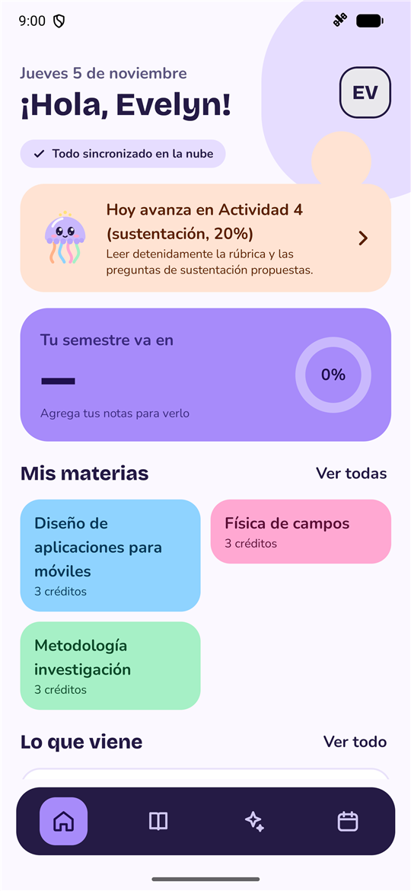
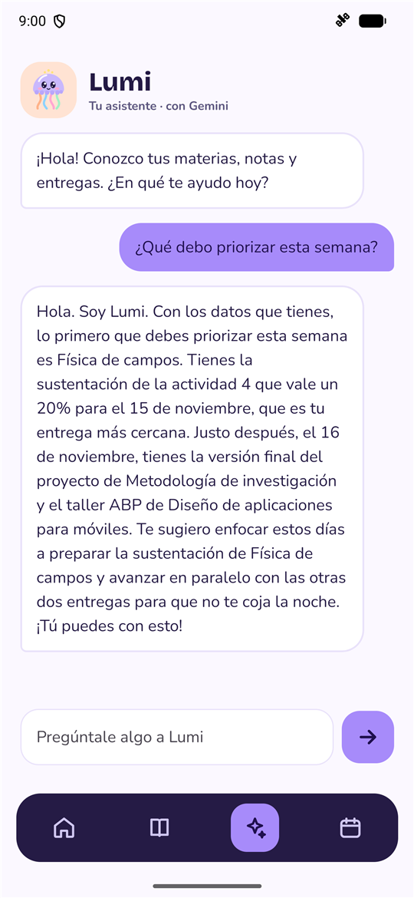
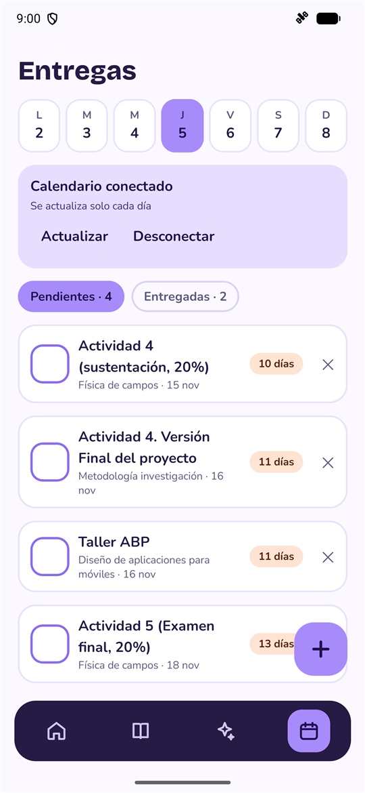
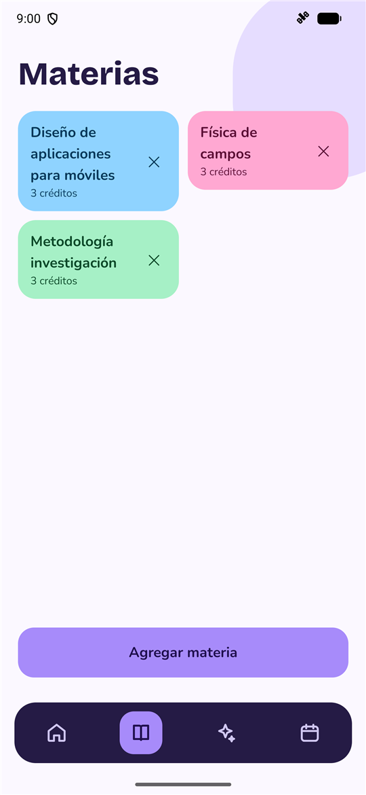
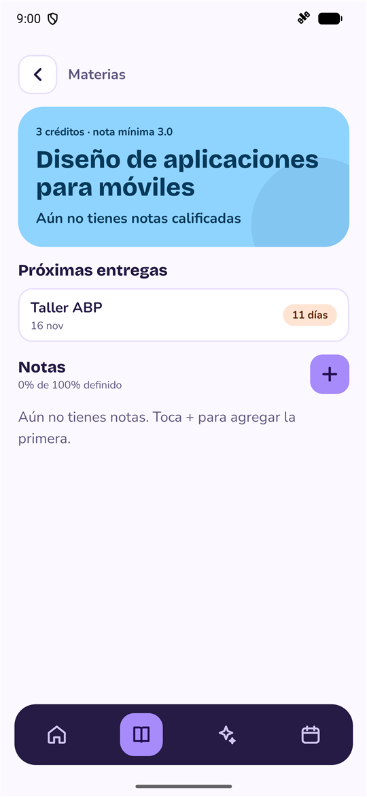
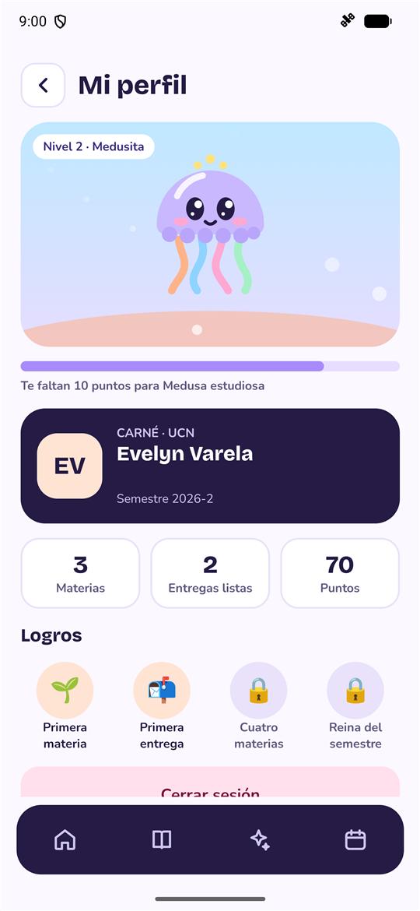
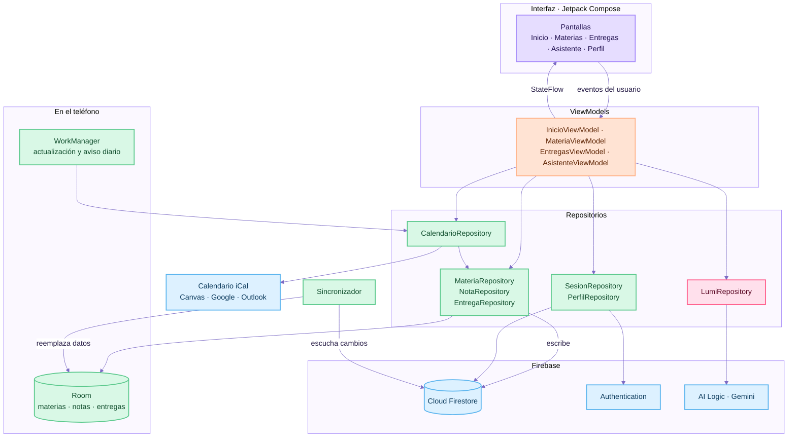
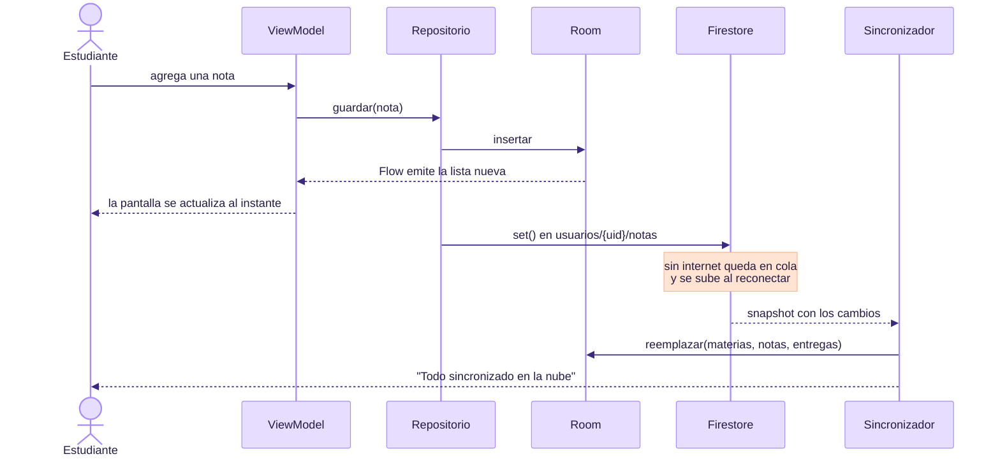
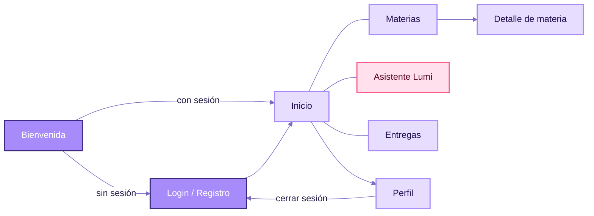

# Mi Semestre

App Android para organizar el semestre universitario: materias, notas, promedio y entregas en un solo lugar, con **Lumi**, una medusita asistente que usa Gemini para ayudarte a decidir qué hacer primero.

> Proyecto individual del Taller ABP · Diseño de Aplicaciones para Móviles · UCN · 2026-2
> Autora: Evelyn Varela

| | |
|---|---|
| **Plataforma** | Android 8.0 (API 26) o superior |
| **Lenguaje** | Kotlin + Jetpack Compose |
| **Arquitectura** | MVVM con repositorios, offline-first |
| **Nube** | Firebase Auth, Cloud Firestore y Firebase AI Logic (Gemini) |
| **Video de sustentación** | _(enlace pendiente)_ |
| **Diapositivas** | [PDF](presentacion/Mi-Semestre.pdf) · [PowerPoint](presentacion/Mi-Semestre.pptx) |

---

## Tabla de contenido

1. [El problema](#el-problema)
2. [Qué hace la app](#qué-hace-la-app)
3. [Evidencia](#evidencia)
4. [Arquitectura](#arquitectura)
5. [Tecnologías](#tecnologías)
6. [Estructura del proyecto](#estructura-del-proyecto)
7. [Instalación y despliegue](#instalación-y-despliegue)
8. [Pruebas](#pruebas)
9. [Seguridad y privacidad](#seguridad-y-privacidad)
10. [Trabajo futuro](#trabajo-futuro)
11. [Documentación completa](#documentación-completa)
12. [Créditos y licencias](#créditos-y-licencias)

---

## El problema

Un estudiante lleva sus notas en una hoja de cálculo, las fechas en Canvas, los recordatorios en otra app y las dudas en un chat aparte. Con tantas fuentes es fácil olvidar una entrega o no saber cuánto necesita sacar para aprobar.

**Mi Semestre** junta todo eso y además responde la pregunta que más cuesta: *¿qué hago hoy?*

## Qué hace la app

### Funciones principales

- **Cuenta propia y datos en la nube.** Registro e inicio de sesión con correo, con opción de ver la contraseña y de recuperarla por correo. Las materias, notas y entregas se guardan en el teléfono y se sincronizan con Firestore, así que funcionan sin internet y no se pierden al cambiar de equipo.
- **Materias y notas.** Cada materia tiene créditos y notas con su porcentaje. La app calcula el promedio de lo evaluado, cuánto falta por definir y la **nota mínima que necesitas** en lo que queda para aprobar con 3.0.
- **Promedio del semestre** ponderado por créditos, visible en Inicio.
- **Entregas.** Lista de pendientes y entregadas, semana con días tocables para filtrar, deslizar para marcar como lista o borrar, y edición de nombre, materia y fecha.
- **Conexión con cualquier calendario.** Pegas el enlace iCal de Canvas, Google Calendar u Outlook y la app importa las entregas de los próximos 180 días. Se actualiza sola cada día, limpia los nombres largos de las materias y respeta las entregas que editaste a mano.
- **Materias desde Canvas.** Si el calendario trae materias que aún no creaste, la app las sugiere con el nombre ya escrito; solo pones los créditos.
- **Recordatorios.** Aviso a las 8:00 con lo que vence hoy o mañana.

### Lo innovador: Lumi

Lumi no es un dibujo decorativo: reacciona a lo que pasa en la app.

- **Plan del día.** Inicio elige tu prioridad con una regla propia: primero lo vencido, luego lo de hoy y después la entrega con más peso (lee el `%` del nombre) dentro de los próximos 7 días. Gemini agrega un primer paso concreto para empezarla; si no hay internet, se muestra un texto local.
- **Asistente con Gemini.** Chat que conoce tus materias, notas y entregas reales. Responde qué priorizar, cómo vas o explica un tema con ejemplos, sin hacer la tarea por ti.
- **Reacciones.** Celebra con confeti cuando marcas una entrega o sacas una buena nota, se preocupa si algo está por vencer y te avisa cuando subes de nivel.
- **Niveles y logros.** Ganas puntos por materias y entregas listas: Huevito → Medusita → Medusa estudiosa → Reina del semestre.

## Evidencia

Capturas tomadas en el emulador con datos reales del semestre de la autora (el correo del carné está tapado).

| Inicio | Asistente Lumi | Entregas |
|:---:|:---:|:---:|
|  |  |  |
| Plan del día, promedio y materias | Respuesta de Gemini con tus datos | Calendario de Canvas conectado |

| Materias | Detalle de materia | Perfil |
|:---:|:---:|:---:|
|  |  |  |
| Materias con créditos | Notas y próximas entregas | Nivel, carné y logros |

La demostración completa está en el video de sustentación _(enlace pendiente)_.

## Arquitectura

### Capas (MVVM)

Cada pantalla tiene su `ViewModel`, que nunca habla directo con Room ni con Firebase: pasa por un repositorio. La interfaz solo observa `StateFlow` y se redibuja sola.



### Offline-first: cómo se sincronizan los datos

Room es la única fuente que lee la interfaz. Firestore guarda los cambios aunque no haya internet y los sube cuando vuelve la conexión; el `Sincronizador` escucha la nube y actualiza Room en una sola transacción.



### Importación desde un calendario

```mermaid
%%{init: {'theme': 'base', 'themeVariables': {'primaryColor': '#E6DDFF', 'primaryTextColor': '#251B45', 'primaryBorderColor': '#A78BFA', 'secondaryColor': '#FFE3D3', 'tertiaryColor': '#FBF8FF', 'lineColor': '#7C6BC4', 'textColor': '#251B45', 'clusterBkg': '#FBF8FF', 'clusterBorder': '#A78BFA', 'edgeLabelBackground': '#FFFFFF', 'actorBkg': '#E6DDFF', 'actorBorder': '#A78BFA', 'actorTextColor': '#251B45', 'signalColor': '#3B2A80', 'signalTextColor': '#251B45', 'labelBoxBkgColor': '#FFE3D3', 'labelBoxBorderColor': '#FFB38A', 'noteBkgColor': '#FFE3D3', 'noteBorderColor': '#FFB38A', 'noteTextColor': '#251B45', 'activationBkgColor': '#FFE0EC', 'activationBorderColor': '#FF5C8A', 'cScale0': '#E6DDFF', 'cScale1': '#FFE3D3', 'cScale2': '#A6F0C6', 'cScale3': '#8FD3FF', 'cScale4': '#FFA8D2', 'cScale5': '#FFB38A', 'cScale6': '#A78BFA', 'cScaleLabel0': '#251B45', 'cScaleLabel1': '#251B45', 'cScaleLabel2': '#251B45', 'cScaleLabel3': '#251B45', 'cScaleLabel4': '#251B45', 'cScaleLabel5': '#251B45', 'cScaleLabel6': '#251B45'}}}%%
flowchart LR
    A["Enlace iCal<br/>webcal:// o https://"] --> B["normalizarEnlace"]
    B --> C["Descarga<br/>máx. 5 MB · 15 s"]
    C --> D["leerCalendario<br/>eventos VEVENT"]
    D --> E["nombreDeMateria<br/>limpia nombres de Canvas"]
    E --> F{"cambiosDeCalendario"}
    F -- "nueva, dentro de 180 días" --> G["crear entrega"]
    F -- "cambió fecha o nombre" --> H["actualizar"]
    F -- "editada a mano" --> I["no tocar"]
    G & H --> J["EntregaRepository<br/>Room + Firestore"]
    J --> K["materiasSinCrear<br/>sugiere materias nuevas"]

    classDef interfaz fill:#E6DDFF,stroke:#A78BFA,stroke-width:2px,color:#20104F
    classDef logica fill:#FFE3D3,stroke:#FFB38A,stroke-width:2px,color:#5C2200
    classDef datos fill:#D9F8E6,stroke:#5CC98D,stroke-width:2px,color:#0F4D2C
    classDef nube fill:#DDF1FF,stroke:#5AB4EE,stroke-width:2px,color:#0B3A5C
    classDef lumi fill:#FFE0EC,stroke:#FF5C8A,stroke-width:2px,color:#5C0A26
    classDef actor fill:#20104F,stroke:#20104F,stroke-width:2px,color:#FFFFFF
    classDef decision fill:#FFF4D6,stroke:#E0A800,stroke-width:2px,color:#4D3800
    classDef extremo fill:#A78BFA,stroke:#3B2A80,stroke-width:2px,color:#FFFFFF
    class A,B,C,D,E interfaz
    class F decision
    class G,H,I logica
    class J datos
    class K lumi
```



### Navegación



Inicio, Materias, Asistente y Entregas están en la barra inferior; Perfil se abre desde el avatar.

### Modelo de datos

En Firestore todo cuelga del usuario, así cada cuenta solo ve lo suyo:

```
usuarios/{uid}/materias/{id}   nombre, créditos
usuarios/{uid}/notas/{id}      materiaId, nombre, peso (%), valor
usuarios/{uid}/entregas/{id}   nombre, materia, fecha, entregada, importada, editada
usuarios/{uid}/perfil/datos    universidad, semestre
```

Room guarda las mismas tres tablas (`materias`, `notas`, `entregas`) para trabajar sin conexión.

## Tecnologías

| Área | Herramienta | Versión |
|---|---|---|
| Lenguaje | Kotlin | 2.2.10 |
| Interfaz | Jetpack Compose (BOM) + Material 3 | 2026.02.01 |
| Navegación | Navigation Compose | 2.9.0 |
| Base local | Room + KSP | 2.8.5 |
| Tareas en segundo plano | WorkManager | 2.10.5 |
| Estado | ViewModel + StateFlow + corrutinas | lifecycle 2.9.4 |
| Nube | Firebase Auth y Cloud Firestore (BoM) | 34.15.0 |
| Inteligencia artificial | Firebase AI Logic · `gemini-3.5-flash-lite` | — |
| Protección de la API | Firebase App Check | debug / Play Integrity |
| Compilación | Android Gradle Plugin | 9.4.1 |

`compileSdk` y `targetSdk` 37, `minSdk` 26.

## Estructura del proyecto

```
app/src/main/java/com/evelynvarela/misemestre/
├── MainActivity.kt, MiSemestreApp.kt   arranque, App Check y sincronización
├── navegacion/                         rutas y barra inferior
├── data/                               modelos, DAOs, repositorios y lógica
│   ├── CalculadoraNotas.kt             promedio y nota necesaria
│   ├── Calendario.kt                   lector iCal y reglas de importación
│   ├── PlanDelDia.kt                   prioridad del día y frase de Lumi
│   ├── Sincronizador.kt                Firestore → Room
│   └── Recordatorios.kt                WorkManager y notificaciones
└── ui/
    ├── componentes/                    Lumi animada, reacciones, píldoras
    ├── entregas/                       pantalla, tarjetas, fila deslizable y diálogos
    ├── inicio/, materias/, materia/, asistente/, perfil/, login/
    └── theme/                          colores y tipografías
app/src/test/                           pruebas unitarias
docs/capturas/                          imágenes de este README
presentacion/                           diapositivas de la sustentación (PDF y PowerPoint)
firestore.rules                         reglas de seguridad de la base
```

## Instalación y despliegue

### Requisitos

- Android Studio reciente con soporte para AGP 9.4 (trae su propio JDK).
- Android SDK 37.
- Un emulador o teléfono con Android 8.0 o superior y Google Play Services.

### Opción A: compilar con el Firebase del proyecto

El repositorio incluye `app/google-services.json`, así que la app se conecta sola al proyecto de Firebase de la autora.

```bash
git clone https://github.com/EvelynVarela171/mi-semestre.git
```

1. Abre la carpeta en Android Studio y espera a que Gradle sincronice.
2. Elige un emulador y pulsa **Run**.
3. Crea una cuenta desde la pantalla de registro.

> **Sobre Lumi:** en compilaciones *debug*, Gemini está protegido por App Check con un token de depuración. El primer arranque imprime en Logcat una línea `DebugAppCheckProvider: Enter this debug secret...`; ese token debe registrarlo la dueña del proyecto en Firebase → App Check. Sin él, todo funciona menos las respuestas de Lumi, que muestran un texto local.

También se puede compilar por consola:

```bash
./gradlew :app:assembleDebug
```

El APK queda en `app/build/outputs/apk/debug/app-debug.apk`.

### Opción B: usar tu propio Firebase

1. Crea un proyecto en [Firebase](https://console.firebase.google.com) y agrega una app Android con el paquete `com.evelynvarela.misemestre`.
2. Descarga tu `google-services.json` y reemplaza el de `app/`.
3. Activa **Authentication → Correo y contraseña**.
4. Crea una base **Cloud Firestore** y publica las reglas de `firestore.rules` (pegándolas en la consola o con `firebase deploy --only firestore:rules`).
5. Activa **AI Logic** con la Gemini Developer API.
6. Activa **App Check**, ejecuta la app una vez y registra el token de depuración que aparece en Logcat.

### Conectar el calendario de Canvas

1. En Canvas entra a **Calendario** y copia el enlace del feed del calendario (*Calendar Feed*), que está abajo a la derecha.
2. En la app ve a **Entregas → Conecta tu calendario** y pégalo.

También sirve la dirección secreta iCal de Google Calendar o el enlace ICS de Outlook. El enlace es personal: no lo compartas.

## Pruebas

37 pruebas unitarias con JUnit cubren la lógica que no depende de Android:

| Archivo | Qué prueba |
|---|---|
| `CalculadoraNotasTest` | promedio, porcentaje evaluado y nota necesaria |
| `ResumenSemestreTest` | promedio del semestre ponderado por créditos |
| `CalendarioTest` | lectura iCal, enlaces, nombres de Canvas, importación y materias sugeridas |
| `PlanDelDiaTest` | prioridad del día: vencidas, hoy, peso y cercanía |
| `ContextoLumiTest` | datos que recibe Gemini |
| `SincronizacionTest` | estado de la nube |

```bash
./gradlew :app:testDebugUnitTest
```

Además, cada función se probó en el emulador (Android 17, API 37) con datos reales.

## Seguridad y privacidad

- **Cada usuario solo accede a sus datos.** Las reglas de Firestore exigen `request.auth.uid == uid` en todo `usuarios/{uid}`.
- **`google-services.json` no es una contraseña.** Identifica el proyecto; la protección real está en las reglas y en App Check.
- **Gemini solo recibe lo necesario:** nombres de materias, notas y fechas de entregas, nunca el correo ni el enlace del calendario.
- **El enlace del calendario se queda en el teléfono.** No se sube a la nube y se borra si entra otra cuenta.
- **Sin sesión no se actualiza nada** en segundo plano.

## Trabajo futuro

- **Importar notas desde Canvas** con su API y un token de acceso (el calendario iCal no trae notas).
- **Dividir una entrega en pasos** con Lumi y marcarlos uno por uno.
- **Modo oscuro.**
- **Widget** con el plan del día en la pantalla de inicio del teléfono.
- Opción **"No la entregué"** para cerrar entregas vencidas sin borrarlas.
- Publicación en Google Play con App Check por Play Integrity.

## Documentación completa

La carpeta [`docs/`](docs/README.md) tiene el detalle del diseño y del proceso:

- [Visión y alcance](docs/01-vision-y-alcance.md): problema, usuarios, objetivos y glosario.
- [Historias de usuario](docs/02-historias-de-usuario.md): 20 historias con criterios de aceptación, prioridad y estado.
- [Requisitos](docs/03-requisitos.md): funcionales, no funcionales y matriz de trazabilidad.
- [Diagramas UML](docs/04-diagramas-uml.md): casos de uso, clases, entidad-relación, secuencia, estados, actividad, componentes y despliegue.
- [Buenas prácticas](docs/05-buenas-practicas.md): SOLID, código limpio, pruebas, seguridad y deuda técnica.
- [Historial](docs/06-historial.md): iteraciones y problemas resueltos.
- [Decisiones de arquitectura (ADR)](docs/adr/README.md): 10 decisiones con sus alternativas.

## Créditos y licencias

- Tipografías [Bricolage Grotesque](https://fonts.google.com/specimen/Bricolage+Grotesque) y [Nunito](https://fonts.google.com/specimen/Nunito), bajo la [SIL Open Font License 1.1](https://openfontlicense.org).
- Lumi está dibujada con código en Compose para este proyecto.
- Respuestas de Lumi generadas con Gemini de Google mediante Firebase AI Logic.

Proyecto académico de la Universidad Católica del Norte.
