# 2. Historias de usuario

Cada historia sigue el formato **Como / Quiero / Para** y tiene criterios de aceptación en estilo **Dado / Cuando / Entonces**, que es como se verificaron en el emulador.

**Prioridad (MoSCoW):** **M** = imprescindible · **S** = importante · **C** = deseable · **W** = no en esta versión.
**Estimación:** puntos de historia en escala de Fibonacci (1, 2, 3, 5, 8).

## Mapa de historias

```mermaid
%%{init: {'theme': 'base', 'themeVariables': {'primaryColor': '#E6DDFF', 'primaryTextColor': '#251B45', 'primaryBorderColor': '#A78BFA', 'secondaryColor': '#FFE3D3', 'tertiaryColor': '#FBF8FF', 'lineColor': '#7C6BC4', 'textColor': '#251B45', 'clusterBkg': '#FBF8FF', 'clusterBorder': '#A78BFA', 'edgeLabelBackground': '#FFFFFF', 'actorBkg': '#E6DDFF', 'actorBorder': '#A78BFA', 'actorTextColor': '#251B45', 'signalColor': '#3B2A80', 'signalTextColor': '#251B45', 'labelBoxBkgColor': '#FFE3D3', 'labelBoxBorderColor': '#FFB38A', 'noteBkgColor': '#FFE3D3', 'noteBorderColor': '#FFB38A', 'noteTextColor': '#251B45', 'activationBkgColor': '#FFE0EC', 'activationBorderColor': '#FF5C8A', 'cScale0': '#E6DDFF', 'cScale1': '#FFE3D3', 'cScale2': '#A6F0C6', 'cScale3': '#8FD3FF', 'cScale4': '#FFA8D2', 'cScale5': '#FFB38A', 'cScale6': '#A78BFA', 'cScaleLabel0': '#251B45', 'cScaleLabel1': '#251B45', 'cScaleLabel2': '#251B45', 'cScaleLabel3': '#251B45', 'cScaleLabel4': '#251B45', 'cScaleLabel5': '#251B45', 'cScaleLabel6': '#251B45'}}}%%
flowchart LR
    subgraph E1["Épica 1 · Cuenta"]
        H1["HU-01 Registrarme"]
        H2["HU-02 Iniciar sesión"]
        H3["HU-03 Datos en la nube"]
    end
    subgraph E2["Épica 2 · Notas"]
        H4["HU-04 Materias"]
        H5["HU-05 Notas"]
        H6["HU-06 Nota necesaria"]
        H7["HU-07 Promedio semestre"]
    end
    subgraph E3["Épica 3 · Entregas"]
        H8["HU-08 Entregas manuales"]
        H9["HU-09 Gestos y edición"]
        H10["HU-10 Conectar calendario"]
        H11["HU-11 Materias sugeridas"]
        H12["HU-12 Recordatorio"]
    end
    subgraph E4["Épica 4 · Lumi"]
        H13["HU-13 Plan del día"]
        H14["HU-14 Asistente"]
        H15["HU-15 Reacciones"]
        H16["HU-16 Niveles y logros"]
    end
    subgraph E5["Épica 5 · Perfil"]
        H17["HU-17 Carné"]
        H18["HU-18 Cerrar sesión"]
    end
    E1 --> E2 --> E3 --> E4
    E1 --> E5

    classDef interfaz fill:#E6DDFF,stroke:#A78BFA,stroke-width:2px,color:#20104F
    classDef logica fill:#FFE3D3,stroke:#FFB38A,stroke-width:2px,color:#5C2200
    classDef datos fill:#D9F8E6,stroke:#5CC98D,stroke-width:2px,color:#0F4D2C
    classDef nube fill:#DDF1FF,stroke:#5AB4EE,stroke-width:2px,color:#0B3A5C
    classDef lumi fill:#FFE0EC,stroke:#FF5C8A,stroke-width:2px,color:#5C0A26
    classDef actor fill:#20104F,stroke:#20104F,stroke-width:2px,color:#FFFFFF
    classDef decision fill:#FFF4D6,stroke:#E0A800,stroke-width:2px,color:#4D3800
    classDef extremo fill:#A78BFA,stroke:#3B2A80,stroke-width:2px,color:#FFFFFF
    class H1,H2,H3 nube
    class H4,H5,H6,H7 datos
    class H8,H9,H10,H11,H12 logica
    class H13,H14,H15,H16 lumi
    class H17,H18 interfaz
```

## Resumen

| ID | Historia | Épica | Prioridad | Puntos | Estado |
|---|---|---|---|---|---|
| HU-01 | Registrarme con correo | Cuenta | M | 3 | ✅ |
| HU-02 | Iniciar sesión | Cuenta | M | 2 | ✅ |
| HU-03 | Tener mis datos en la nube y sin internet | Cuenta | M | 8 | ✅ |
| HU-04 | Crear y borrar materias | Notas | M | 2 | ✅ |
| HU-05 | Registrar notas con porcentaje | Notas | M | 3 | ✅ |
| HU-06 | Saber cuánto necesito para aprobar | Notas | M | 3 | ✅ |
| HU-07 | Ver el promedio del semestre | Notas | S | 3 | ✅ |
| HU-08 | Agregar entregas a mano | Entregas | M | 2 | ✅ |
| HU-09 | Marcar, editar y filtrar entregas | Entregas | S | 5 | ✅ |
| HU-10 | Conectar el calendario de Canvas | Entregas | S | 8 | ✅ |
| HU-11 | Crear materias desde el calendario | Entregas | C | 3 | ✅ |
| HU-12 | Recibir un recordatorio | Entregas | S | 3 | ✅ |
| HU-13 | Ver qué hacer hoy | Lumi | S | 5 | ✅ |
| HU-14 | Preguntarle a Lumi | Lumi | S | 5 | ✅ |
| HU-15 | Que Lumi reaccione | Lumi | C | 3 | ✅ |
| HU-16 | Subir de nivel y ganar logros | Lumi | C | 3 | ✅ |
| HU-17 | Completar mi carné | Perfil | C | 2 | ✅ |
| HU-18 | Cerrar sesión con seguridad | Perfil | M | 2 | ✅ |
| HU-19 | Dividir una entrega en pasos | Lumi | W | 5 | 🔜 |
| HU-20 | Importar notas desde Canvas | Notas | W | 8 | 🔜 |

**Total hecho:** 18 historias · 65 puntos.

---

## Épica 1 · Cuenta

### HU-01 · Registrarme con correo

**Como** estudiante nuevo, **quiero** crear una cuenta con mi nombre, correo y contraseña, **para** que mis datos sean solo míos.

**Criterios de aceptación**
1. **Dado** que abro la app sin sesión, **cuando** termina la bienvenida, **entonces** veo la pantalla de login con la opción de registrarme.
2. **Dado** que lleno nombre, correo y contraseña válidos, **cuando** toco registrarme, **entonces** entro a Inicio y me saluda por mi primer nombre.
3. **Dado** que el correo ya existe o la contraseña es débil, **cuando** intento registrarme, **entonces** veo un mensaje de error y sigo en el formulario.

**Implementación:** `LoginScreen`, `LoginViewModel.registrar`, `SesionRepository.registrar`.

### HU-02 · Iniciar sesión

**Como** estudiante, **quiero** entrar con mi correo y contraseña, **para** recuperar mis datos en cualquier teléfono.

**Criterios de aceptación**
1. **Dado** que tengo cuenta, **cuando** entro con mis datos, **entonces** veo Inicio con mis materias y entregas.
2. **Dado** que ya inicié sesión antes, **cuando** abro la app, **entonces** paso directo a Inicio sin volver a escribir la contraseña.
3. **Dado** que me equivoco de contraseña, **cuando** intento entrar, **entonces** veo un error y nada se borra.

**Implementación:** `BienvenidaScreen`, `LoginViewModel.entrar`, `SesionRepository.entrar`.

### HU-03 · Tener mis datos en la nube y sin internet

**Como** estudiante, **quiero** que mis datos se guarden en el teléfono y en la nube, **para** usarlos sin internet y no perderlos si cambio de celular.

**Criterios de aceptación**
1. **Dado** que no tengo internet, **cuando** agrego una nota, **entonces** se ve al instante y el indicador dice "Sin conexión: guardado en tu teléfono".
2. **Dado** que vuelve la conexión, **cuando** pasan unos segundos, **entonces** el indicador cambia a "Todo sincronizado en la nube".
3. **Dado** que entro en otro teléfono con la misma cuenta, **cuando** carga Inicio, **entonces** veo las mismas materias, notas y entregas.
4. **Dado** que otra persona entra con su cuenta, **cuando** carga Inicio, **entonces** no ve ningún dato mío.

**Implementación:** `Sincronizador`, `NubeRepository`, `SincronizacionDao.reemplazar`, `firestore.rules`. Ver [ADR-0003](adr/0003-offline-first-room-firestore.md).

---

## Épica 2 · Notas

### HU-04 · Crear y borrar materias

**Como** estudiante, **quiero** agregar mis materias con sus créditos, **para** organizar mis notas por asignatura.

**Criterios de aceptación**
1. **Dado** que estoy en Materias, **cuando** agrego una con nombre y créditos, **entonces** aparece en la lista y en Inicio.
2. **Dado** que una materia tiene 1 crédito, **cuando** la veo, **entonces** dice "1 crédito" y no "1 créditos".
3. **Dado** que borro una materia, **cuando** confirmo, **entonces** también se borran sus notas.

**Implementación:** `MateriasScreen`, `MateriaRepository`, `Nota` con `ForeignKey.CASCADE`.

### HU-05 · Registrar notas con porcentaje

**Como** estudiante, **quiero** anotar cada evaluación con su porcentaje y, si ya la tengo, su nota, **para** ver cómo voy en la materia.

**Criterios de aceptación**
1. **Dado** que estoy en el detalle de una materia, **cuando** agrego "Parcial 1, 30%, 4.2", **entonces** aparece en la lista y el promedio se actualiza.
2. **Dado** que todavía no tengo la nota, **cuando** la dejo vacía, **entonces** queda "sin calificar" y no cuenta en el promedio.
3. **Dado** que tengo notas, **cuando** miro el encabezado, **entonces** veo cuánto del 100% está definido.

**Implementación:** `MateriaScreen`, `MateriaViewModel`, `NotaRepository`.

### HU-06 · Saber cuánto necesito para aprobar

**Como** estudiante, **quiero** saber qué nota necesito en lo que falta, **para** decidir cuánto esfuerzo poner.

**Criterios de aceptación**
1. **Dado** que tengo 4.0 en el 50% de la materia, **cuando** miro el detalle, **entonces** veo que necesito al menos 2.0 en el 50% restante para llegar a 3.0.
2. **Dado** que la nota necesaria tiene decimales, **cuando** se muestra, **entonces** se redondea hacia arriba a un decimal, para no quedar corta.
3. **Dado** que ya está calificado el 100%, **cuando** miro el detalle, **entonces** no se muestra una nota necesaria.

**Implementación:** `CalculadoraNotas.notaNecesaria` y `formatoNecesaria`. Probado en `CalculadoraNotasTest`.

### HU-07 · Ver el promedio del semestre

**Como** estudiante, **quiero** ver mi promedio general ponderado por créditos, **para** saber cómo va mi semestre completo.

**Criterios de aceptación**
1. **Dado** que tengo notas en varias materias, **cuando** abro Inicio, **entonces** veo el promedio ponderado por créditos y el porcentaje de avance.
2. **Dado** que una materia no tiene notas calificadas, **cuando** se calcula, **entonces** no baja el promedio.
3. **Dado** que no tengo notas, **cuando** abro Inicio, **entonces** veo "Agrega tus notas para verlo".

**Implementación:** `CalculadoraNotas.resumenSemestre`. Probado en `ResumenSemestreTest`.

---

## Épica 3 · Entregas

### HU-08 · Agregar entregas a mano

**Como** estudiante, **quiero** anotar una entrega con nombre, materia y fecha, **para** no olvidarla aunque no esté en Canvas.

**Criterios de aceptación**
1. **Dado** que estoy en Entregas, **cuando** agrego una, **entonces** aparece en Pendientes ordenada por fecha, con "Hoy", "Mañana", "N días" o "Vencida".
2. **Dado** que vence en 3 días o menos, **cuando** la veo, **entonces** su etiqueta es fucsia para llamar la atención.
3. **Dado** que la app aún no tiene permiso de notificaciones, **cuando** guardo una entrega, **entonces** lo pide.

**Implementación:** `DialogoEntrega`, `EntregasViewModel.agregar`, `textoDias`, `esUrgente`.

### HU-09 · Marcar, editar y filtrar entregas

**Como** estudiante, **quiero** marcar entregas como listas, editarlas y ver solo las de un día, **para** manejar mi semana rápido.

**Criterios de aceptación**
1. **Dado** una entrega pendiente, **cuando** la deslizo o toco su casilla, **entonces** pasa a Entregadas y Lumi lo celebra.
2. **Dado** que toco un día de la semana, **cuando** se filtra, **entonces** veo "Entregas del X" y puedo volver con "Ver todas".
3. **Dado** que edito una entrega importada, **cuando** se actualiza el calendario, **entonces** mis cambios no se pisan.
4. **Dado** que borro una entrega importada, **cuando** se actualiza el calendario, **entonces** no vuelve a aparecer.

**Implementación:** `FilaDeslizable`, `EntregasViewModel.editar`, campos `editada` y `oculta`. Ver [ADR-0010](adr/0010-borrado-suave-de-importadas.md).

### HU-10 · Conectar el calendario de Canvas

**Como** estudiante, **quiero** pegar el enlace de mi calendario, **para** que mis entregas lleguen solas.

**Criterios de aceptación**
1. **Dado** un enlace `webcal://` o `https://` válido, **cuando** lo conecto, **entonces** se importan las entregas de los próximos 180 días y veo cuántas llegaron.
2. **Dado** que Canvas pone nombres largos como "Actividad [Código-Curso-Grupo]", **cuando** se importan, **entonces** la materia aparece con un nombre limpio.
3. **Dado** que el enlace no es un calendario, **cuando** intento conectarlo, **entonces** veo "Ese enlace no parece ser de un calendario".
4. **Dado** que ya estoy conectada y falla internet, **cuando** actualizo, **entonces** el mensaje aclara que el calendario sigue conectado.
5. **Dado** que desconecto el calendario, **cuando** confirmo, **entonces** se quitan las importadas y se quedan las que agregué a mano.
6. **Dado** que cierro sesión y vuelvo con la misma cuenta, **cuando** entro, **entonces** el calendario sigue conectado.

**Implementación:** `CalendarioRepository`, `leerCalendario`, `cambiosDeCalendario`, `EnlaceCalendario`. Ver [ADR-0006](adr/0006-importar-calendario-ical.md) y [ADR-0008](adr/0008-enlace-del-calendario-solo-local.md).

### HU-11 · Crear materias desde el calendario

**Como** estudiante, **quiero** que la app me sugiera las materias que vienen en el calendario, **para** no escribir sus nombres.

**Criterios de aceptación**
1. **Dado** que el calendario trae materias que no he creado, **cuando** abro Entregas, **entonces** veo "Encontré N materias nuevas".
2. **Dado** que toco la tarjeta, **cuando** pongo los créditos y confirmo, **entonces** se crean y se conectan con sus entregas por nombre.
3. **Dado** que elijo "Ahora no", **cuando** vuelvo a Entregas, **entonces** la tarjeta no aparece hasta que toque Actualizar.

**Implementación:** `materiasSinCrear`, `TarjetaMateriasNuevas`, `DialogoCrearMaterias`.

### HU-12 · Recibir un recordatorio

**Como** estudiante, **quiero** un aviso en la mañana, **para** acordarme de lo que vence hoy o mañana.

**Criterios de aceptación**
1. **Dado** que tengo entregas pendientes para hoy o mañana, **cuando** son las 8:00, **entonces** recibo una notificación por cada una.
2. **Dado** que ya recibí el aviso hoy, **cuando** la tarea vuelve a correr, **entonces** no se repite.
3. **Dado** que no hay sesión iniciada, **cuando** corre la tarea, **entonces** no actualiza ni avisa nada.
4. **Dado** que abro la app después de las 8:00 y hoy aún no hubo aviso, **cuando** se abre, **entonces** recibo el aviso en ese momento.

**Implementación:** `Recordatorios.programar`, `RecordatorioWorker`. Ver [ADR-0007](adr/0007-workmanager-recordatorios.md).

---

## Épica 4 · Lumi

### HU-13 · Ver qué hacer hoy

**Como** estudiante, **quiero** que Inicio me diga cuál es mi prioridad, **para** empezar sin pensar demasiado.

**Criterios de aceptación**
1. **Dado** que tengo una entrega vencida, **cuando** abro Inicio, **entonces** Lumi se preocupa y dice "Tienes 1 entrega vencida".
2. **Dado** que no hay vencidas pero algo vence hoy, **cuando** abro Inicio, **entonces** esa es la prioridad.
3. **Dado** que hay varias en los próximos 7 días, **cuando** abro Inicio, **entonces** se elige la que más pesa según el `%` de su nombre.
4. **Dado** que hay internet, **cuando** se elige la prioridad, **entonces** Gemini agrega un primer paso de máximo 12 palabras, sin saludar; si no, se muestra el plazo y el peso.
5. **Dado** que ya se generó la frase hoy para esa entrega, **cuando** vuelvo a abrir la app, **entonces** se reutiliza sin volver a llamar a Gemini.

**Implementación:** `planDelDia`, `FraseDelPlan`, `LumiRepository.fraseDelDia`. Probado en `PlanDelDiaTest`.

### HU-14 · Preguntarle a Lumi

**Como** estudiante, **quiero** preguntarle a Lumi sobre mis materias, **para** recibir ayuda con mis datos reales.

**Criterios de aceptación**
1. **Dado** que abro el asistente, **cuando** toco una pregunta sugerida, **entonces** Lumi responde usando mis materias, notas y entregas.
2. **Dado** que la respuesta es larga, **cuando** se genera, **entonces** aparece de a poco mientras llega.
3. **Dado** que se acabó la cuota gratuita, **cuando** pregunto, **entonces** veo "Ya respondí muchas preguntas por hoy".
4. **Dado** que pido ayuda con un tema, **cuando** responde, **entonces** explica con ejemplos sencillos; sus instrucciones le piden no resolver la tarea completa.

**Implementación:** `AsistenteViewModel`, `contextoParaLumi`, `LumiRepository.responder`. Ver [ADR-0005](adr/0005-gemini-con-firebase-ai-logic.md).

### HU-15 · Que Lumi reaccione

**Como** estudiante, **quiero** que Lumi reaccione a lo que hago, **para** sentir que la app me acompaña.

**Criterios de aceptación**
1. **Dado** que registro una nota de 4.0 o más, **cuando** la guardo, **entonces** Lumi dice "¡Qué buena nota!" con confeti.
2. **Dado** que registro una nota menor a 3.0, **cuando** la guardo, **entonces** Lumi me anima a recuperarla.
3. **Dado** que marco mi última entrega pendiente, **cuando** la marco, **entonces** Lumi dice "¡Terminaste todo!".

**Implementación:** `ReaccionLumi`, `reaccionANota`, `LumiAnimada`.

### HU-16 · Subir de nivel y ganar logros

**Como** estudiante, **quiero** ganar puntos y logros, **para** motivarme a mantener la app al día.

**Criterios de aceptación**
1. **Dado** que tengo materias y entregas listas, **cuando** abro el perfil, **entonces** veo mis puntos (10 por materia y 20 por entrega lista) y cuánto falta para el siguiente nivel.
2. **Dado** que paso de nivel, **cuando** abro el perfil, **entonces** Lumi dice "¡Subiste a …!".
3. **Dado** que cumplo una meta, **cuando** miro Logros, **entonces** la insignia aparece desbloqueada.

**Implementación:** `PerfilScreen` (`puntosDe`, `nivelDe`, niveles Huevito → Reina del semestre).

---

## Épica 5 · Perfil

### HU-17 · Completar mi carné

**Como** estudiante, **quiero** poner mi universidad y semestre, **para** ver un carné con mis datos.

**Criterios de aceptación**
1. **Dado** que abro el perfil, **cuando** toco el carné, **entonces** puedo editar universidad y semestre.
2. **Dado** que no he puesto semestre, **cuando** lo veo, **entonces** se calcula solo con la fecha (por ejemplo 2026-2).
3. **Dado** que cambio de teléfono, **cuando** entro, **entonces** el carné conserva mis datos.

**Implementación:** `DialogoCarne`, `PerfilRepository`, `semestreDe`.

### HU-18 · Cerrar sesión con seguridad

**Como** estudiante, **quiero** cerrar sesión, **para** que otra persona no vea mis datos en este teléfono.

**Criterios de aceptación**
1. **Dado** que toco "Cerrar sesión" y confirmo, **cuando** termina, **entonces** vuelvo al login y se borran los datos locales del teléfono.
2. **Dado** que entra otra cuenta, **cuando** inicia sesión, **entonces** no ve mi enlace de calendario ni mis datos.

**Implementación:** `SesionRepository.salir`, `Sincronizador.iniciar`, `enlaceDeOtraCuenta`. Probado en `CalendarioTest`.

---

## Trabajo futuro

### HU-19 · Dividir una entrega en pasos 🔜

**Como** estudiante, **quiero** que Lumi divida una entrega grande en pasos pequeños, **para** avanzar sin agobiarme.

**Criterios de aceptación propuestos**
1. **Dado** una entrega pendiente, **cuando** toco "Divídela en pasos", **entonces** Lumi propone de 3 a 5 pasos.
2. **Dado** que marco pasos, **cuando** los completo todos, **entonces** Lumi pregunta si marco la entrega como lista.

**Motivo para dejarla fuera:** se priorizó la documentación y la sustentación dentro del plazo.

### HU-20 · Importar notas desde Canvas 🔜

**Como** estudiante, **quiero** que mis notas lleguen desde Canvas, **para** no escribirlas.

**Motivo para dejarla fuera:** el calendario iCal no incluye notas; haría falta la API de Canvas con un token personal, que da acceso a toda la cuenta y exige guardarlo con más cuidado. Ver [ADR-0006](adr/0006-importar-calendario-ical.md).

## Definición de hecho

Una historia se marca ✅ solo cuando:

- [x] Cumple todos sus criterios de aceptación, probados en el emulador.
- [x] La lógica sin Android tiene pruebas unitarias que pasan.
- [x] Compila sin errores y no hay fallos en Logcat.
- [x] Funciona sin internet o muestra un mensaje claro si necesita conexión.
- [x] Se sube a GitHub con un commit descriptivo.
