# 4. Diagramas UML

Todos los diagramas siguen la notación UML y están escritos en Mermaid, así que GitHub los dibuja y se pueden editar como texto. Los nombres coinciden con las clases y funciones del código.

| # | Diagrama | Tipo UML | Para qué sirve |
|---|---|---|---|
| 4.1 | [Casos de uso](#41-diagrama-de-casos-de-uso) | Comportamiento | Qué puede hacer cada actor |
| 4.2 | [Clases del dominio](#42-diagrama-de-clases-del-dominio) | Estructura | Entidades y sus relaciones |
| 4.3 | [Clases por capas](#43-diagrama-de-clases-por-capas) | Estructura | ViewModels, repositorios y DAO |
| 4.4 | [Entidad-relación de Room](#44-modelo-entidad-relación-de-la-base-local) | Estructura | Tablas de la base local |
| 4.5 | [Secuencia: conectar el calendario](#45-diagrama-de-secuencia-conectar-el-calendario) | Interacción | Importación iCal paso a paso |
| 4.6 | [Secuencia: preguntar a Lumi](#46-diagrama-de-secuencia-preguntar-a-lumi) | Interacción | Llamada a Gemini con contexto |
| 4.7 | [Secuencia: plan del día](#47-diagrama-de-secuencia-plan-del-día) | Interacción | Prioridad, caché y respaldo local |
| 4.8 | [Estados de una entrega](#48-diagrama-de-estados-de-una-entrega) | Comportamiento | Ciclo de vida de una entrega |
| 4.9 | [Estados de la nube](#49-diagrama-de-estados-de-la-sincronización) | Comportamiento | Indicador de sincronización |
| 4.10 | [Actividad: elegir la prioridad](#410-diagrama-de-actividad-elegir-la-prioridad-del-día) | Comportamiento | Algoritmo de `planDelDia` |
| 4.11 | [Actividad: aviso diario](#411-diagrama-de-actividad-aviso-diario) | Comportamiento | Trabajo de WorkManager |
| 4.12 | [Componentes](#412-diagrama-de-componentes) | Estructura | Módulos y dependencias |
| 4.13 | [Despliegue](#413-diagrama-de-despliegue) | Estructura | Dónde corre cada parte |

---

## 4.1 Diagrama de casos de uso

Mermaid no tiene un tipo propio de casos de uso, así que se dibuja con la misma notación: actores a los lados, casos de uso como óvalos dentro del límite del sistema y relaciones `«include»` y `«extend»`.

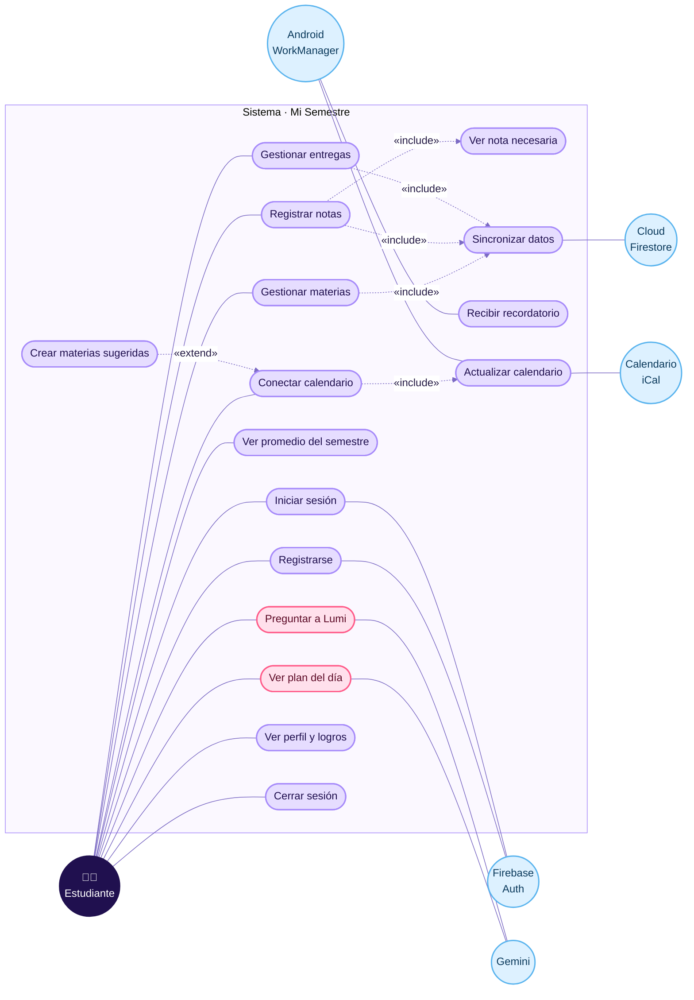

| Caso de uso | Actor principal | Historia |
|---|---|---|
| Registrarse · Iniciar sesión | Estudiante | HU-01, HU-02 |
| Gestionar materias · Registrar notas | Estudiante | HU-04, HU-05 |
| Ver nota necesaria · Ver promedio | Estudiante | HU-06, HU-07 |
| Gestionar entregas | Estudiante | HU-08, HU-09 |
| Conectar y actualizar calendario | Estudiante, WorkManager | HU-10 |
| Crear materias sugeridas | Estudiante | HU-11 |
| Recibir recordatorio | WorkManager | HU-12 |
| Ver plan del día · Preguntar a Lumi | Estudiante | HU-13, HU-14 |
| Ver perfil y logros · Cerrar sesión | Estudiante | HU-16, HU-17, HU-18 |
| Sincronizar datos | Firestore | HU-03 |

---

## 4.2 Diagrama de clases del dominio

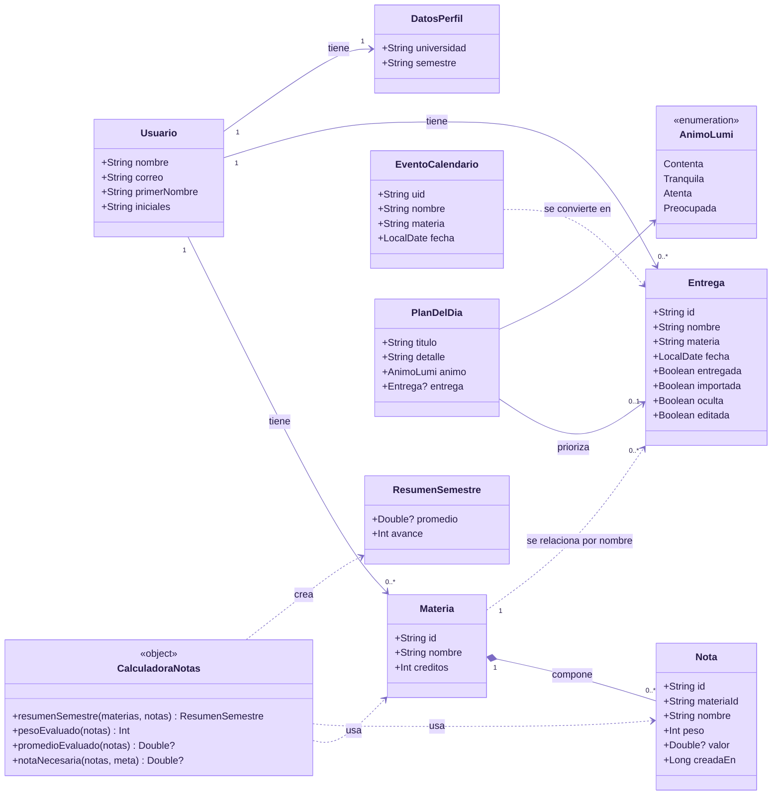

**Decisiones del modelo**

- `Nota` **compone** `Materia` (rombo lleno): al borrar la materia se borran sus notas (`ForeignKey.CASCADE`).
- `Entrega` guarda el **nombre** de la materia, no su `id`, porque las entregas importadas llegan antes de que exista la materia; se relacionan por nombre sin distinguir mayúsculas.
- `valor` es nulo mientras la nota no esté calificada.
- `oculta` y `editada` implementan el borrado suave y el respeto a las ediciones ([ADR-0010](adr/0010-borrado-suave-de-importadas.md)).

---

## 4.3 Diagrama de clases por capas

```mermaid
%%{init: {'theme': 'base', 'themeVariables': {'primaryColor': '#E6DDFF', 'primaryTextColor': '#251B45', 'primaryBorderColor': '#A78BFA', 'secondaryColor': '#FFE3D3', 'tertiaryColor': '#FBF8FF', 'lineColor': '#7C6BC4', 'textColor': '#251B45', 'clusterBkg': '#FBF8FF', 'clusterBorder': '#A78BFA', 'edgeLabelBackground': '#FFFFFF', 'actorBkg': '#E6DDFF', 'actorBorder': '#A78BFA', 'actorTextColor': '#251B45', 'signalColor': '#3B2A80', 'signalTextColor': '#251B45', 'labelBoxBkgColor': '#FFE3D3', 'labelBoxBorderColor': '#FFB38A', 'noteBkgColor': '#FFE3D3', 'noteBorderColor': '#FFB38A', 'noteTextColor': '#251B45', 'activationBkgColor': '#FFE0EC', 'activationBorderColor': '#FF5C8A', 'cScale0': '#E6DDFF', 'cScale1': '#FFE3D3', 'cScale2': '#A6F0C6', 'cScale3': '#8FD3FF', 'cScale4': '#FFA8D2', 'cScale5': '#FFB38A', 'cScale6': '#A78BFA', 'cScaleLabel0': '#251B45', 'cScaleLabel1': '#251B45', 'cScaleLabel2': '#251B45', 'cScaleLabel3': '#251B45', 'cScaleLabel4': '#251B45', 'cScaleLabel5': '#251B45', 'cScaleLabel6': '#251B45'}}}%%
classDiagram
    direction TB

    namespace Presentacion {
        class InicioViewModel {
            +StateFlow resumen
            +StateFlow entregas
            +StateFlow perfil
            +String? fraseDelPlan
            +pedirFrase(plan)
            +guardarPerfil(datos)
        }
        class MateriaViewModel {
            +Flow materia
            +Flow notas
            +Flow entregas
            +agregar(nombre, peso, valor)
            +actualizar(nota)
            +borrar(nota)
        }
        class EntregasViewModel {
            +StateFlow entregas
            +StateFlow materiasSugeridas
            +Boolean conectado
            +agregar(nombre, materia, fecha)
            +editar(entrega, ...)
            +cambiar(entrega)
            +conectar(enlace)
            +actualizar()
            +desconectar()
            +crearMaterias(creditos)
        }
        class AsistenteViewModel {
            +List~Mensaje~ mensajes
            +Boolean pensando
            +enviar(pregunta)
        }
        class LoginViewModel {
            +Boolean cargando
            +String? error
            +entrar(correo, clave)
            +registrar(nombre, correo, clave)
        }
    }

    namespace Datos {
        class MateriaRepository {
            +Flow materias
            +agregar(materia)
            +borrar(materia)
        }
        class NotaRepository {
            +Flow todas
            +notas(materiaId) Flow
            +agregar(nota)
            +actualizar(nota)
            +borrar(nota)
        }
        class EntregaRepository {
            +Flow entregas
            +guardar(entrega)
            +borrar(entrega)
            +borrarImportadas()
        }
        class CalendarioRepository {
            +Boolean conectado
            +conectar(texto) Int
            +actualizar() Int
            +desconectar()
        }
        class LumiRepository {
            +responder(pregunta, contexto) Flow
            +fraseDelDia(prioridad) String?
        }
        class SesionRepository {
            +Usuario? usuario
            +entrar(correo, clave)
            +registrar(nombre, correo, clave)
            +salir()
        }
        class PerfilRepository {
            +Flow datos
            +guardar(datos)
        }
        class NubeRepository {
            +guardar(...)
            +borrar(...)
        }
        class Sincronizador {
            <<singleton>>
            +StateFlow estado
            +iniciar()
        }
        class FraseDelPlan {
            +obtener(hoy, plan) String?
        }
        class EnlaceCalendario {
            +String? url
            +String? dueno
            +Set materiasIgnoradas
            +olvidar()
        }
    }

    namespace Persistencia {
        class AppDatabase {
            <<singleton>>
            +materiaDao()
            +notaDao()
            +entregaDao()
            +sincronizacionDao()
        }
        class MateriaDao {
            <<interface>>
        }
        class NotaDao {
            <<interface>>
        }
        class EntregaDao {
            <<interface>>
        }
        class SincronizacionDao {
            <<interface>>
            +reemplazar(materias, notas, entregas)
            +borrarTodo()
        }
    }

    InicioViewModel --> MateriaRepository
    InicioViewModel --> NotaRepository
    InicioViewModel --> EntregaRepository
    InicioViewModel --> PerfilRepository
    InicioViewModel --> FraseDelPlan
    MateriaViewModel --> NotaRepository
    MateriaViewModel --> MateriaRepository
    EntregasViewModel --> EntregaRepository
    EntregasViewModel --> CalendarioRepository
    EntregasViewModel --> MateriaRepository
    AsistenteViewModel --> LumiRepository
    LoginViewModel --> SesionRepository

    FraseDelPlan --> LumiRepository
    CalendarioRepository --> EntregaRepository
    CalendarioRepository --> EnlaceCalendario
    MateriaRepository --> MateriaDao
    MateriaRepository --> NubeRepository
    NotaRepository --> NotaDao
    NotaRepository --> NubeRepository
    EntregaRepository --> EntregaDao
    EntregaRepository --> NubeRepository
    Sincronizador --> SincronizacionDao
    Sincronizador --> EnlaceCalendario
    AppDatabase ..> MateriaDao : crea
    AppDatabase ..> NotaDao : crea
    AppDatabase ..> EntregaDao : crea
    AppDatabase ..> SincronizacionDao : crea
```

---

## 4.4 Modelo entidad-relación de la base local

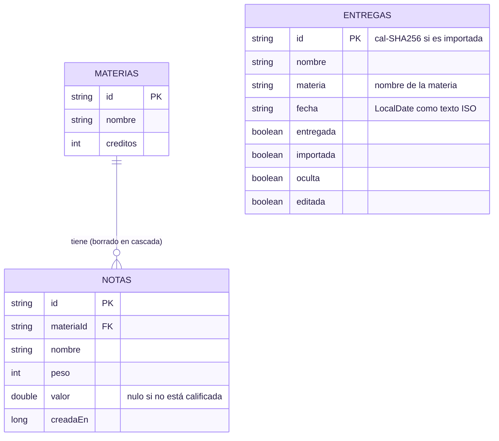

Base `mi_semestre.db`, versión 5. Las fechas se guardan como texto con `Convertidores`. En Firestore la estructura es la misma, bajo `usuarios/{uid}/`.

---

## 4.5 Diagrama de secuencia: conectar el calendario

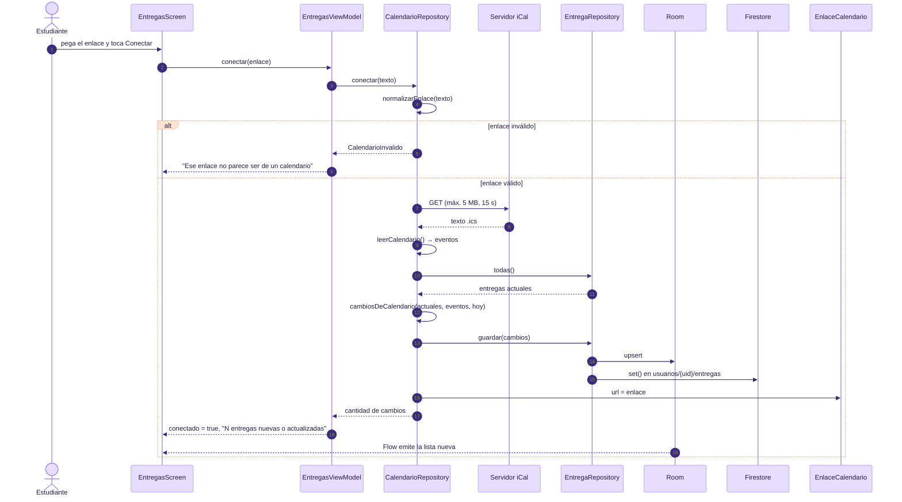

---

## 4.6 Diagrama de secuencia: preguntar a Lumi

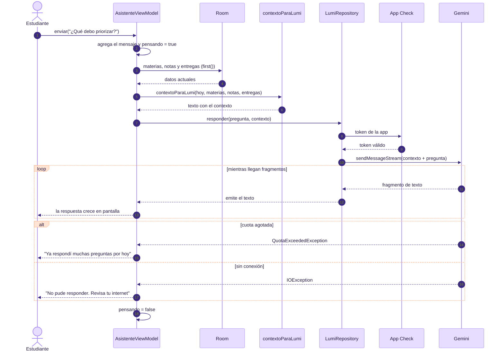

---

## 4.7 Diagrama de secuencia: plan del día

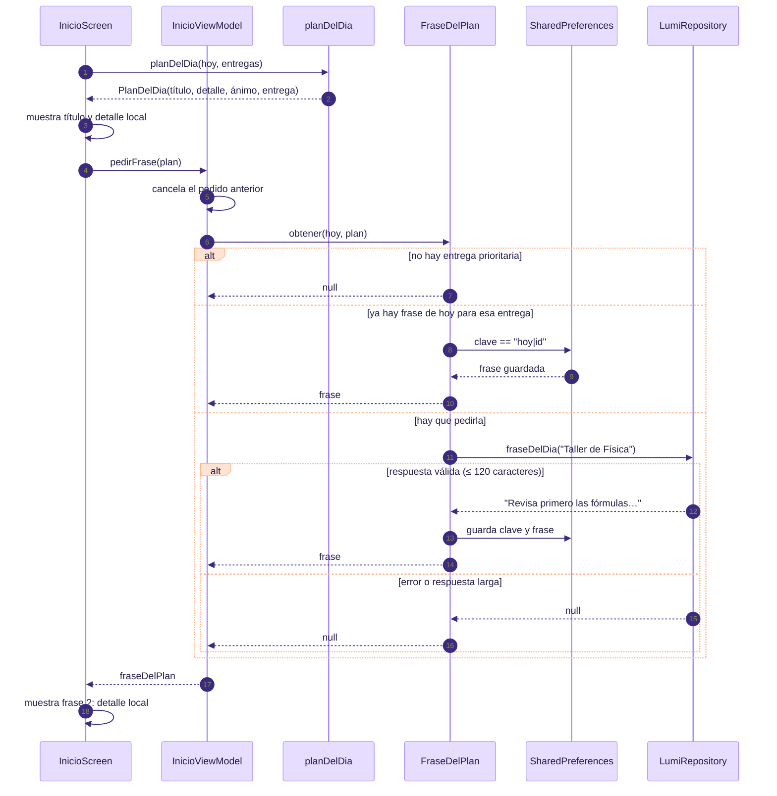

---

## 4.8 Diagrama de estados de una entrega

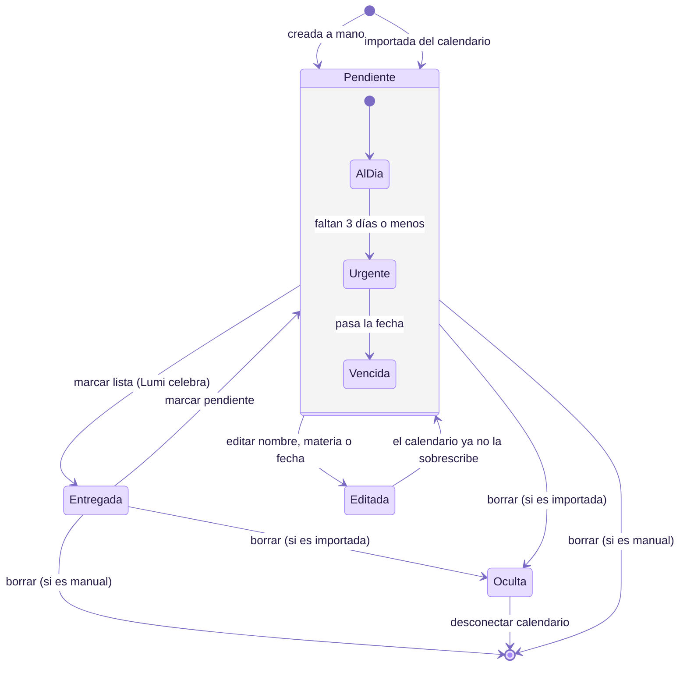

| Estado | Cómo se ve en la app |
|---|---|
| Al día | Etiqueta durazno con "N días" |
| Urgente | Etiqueta fucsia: "Hoy", "Mañana" o "N días" |
| Vencida | Etiqueta fucsia "Vencida"; Lumi preocupada en Inicio |
| Entregada | Pestaña "Entregadas" |
| Oculta | No se muestra, pero evita que el calendario la vuelva a crear |

---

## 4.9 Diagrama de estados de la sincronización

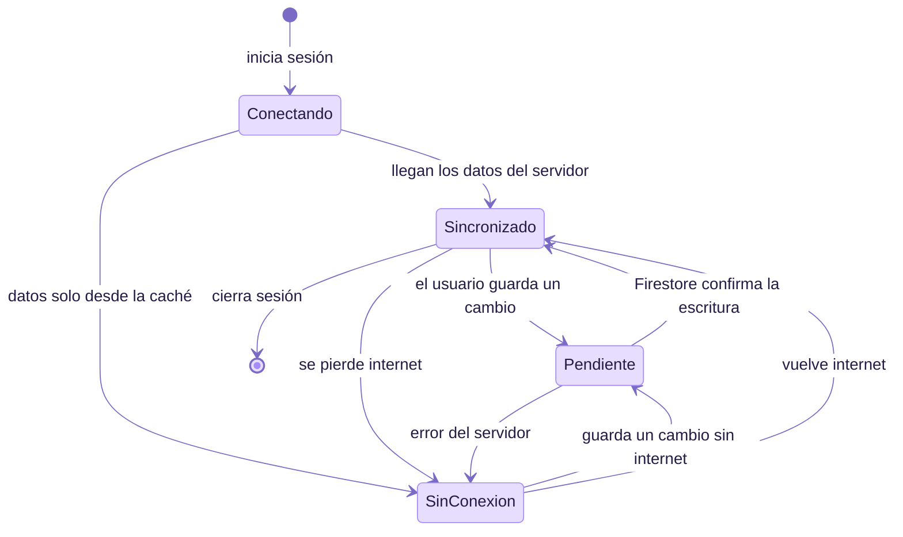

`estadoDe(hayPendientes, soloCache)` decide el estado: lo pendiente gana sobre la falta de conexión (prueba `loPendienteGanaSobreLaFaltaDeConexion`).

---

## 4.10 Diagrama de actividad: elegir la prioridad del día

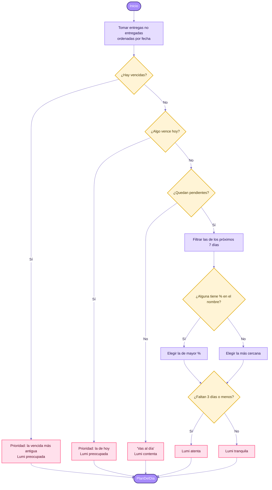

---

## 4.11 Diagrama de actividad: aviso diario

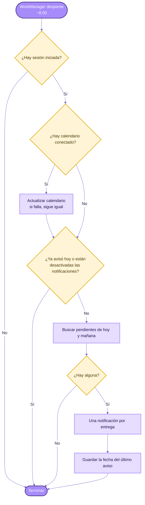

---

## 4.12 Diagrama de componentes

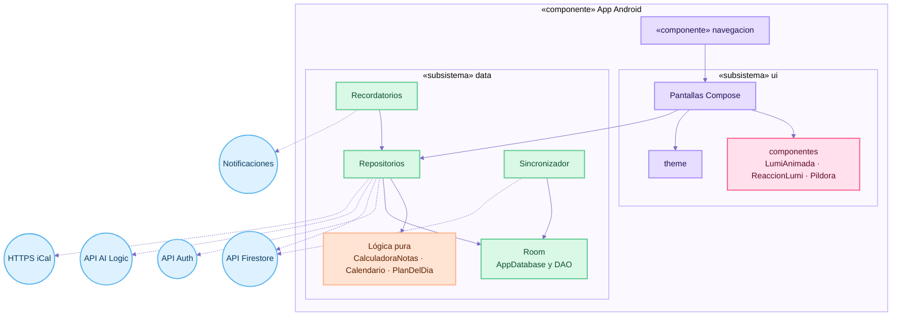

---

## 4.13 Diagrama de despliegue

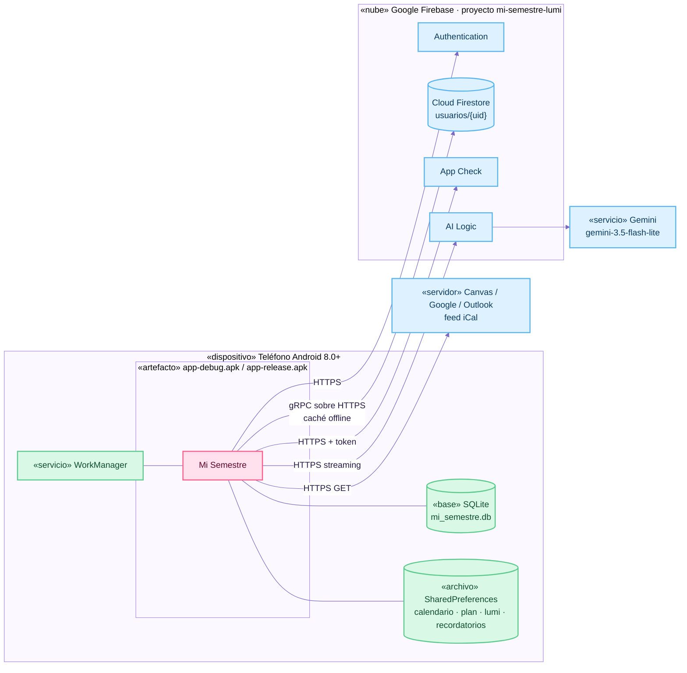
