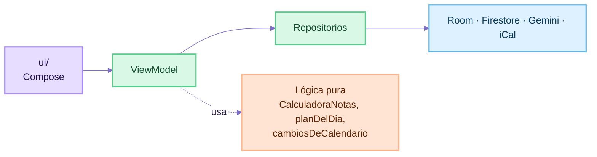
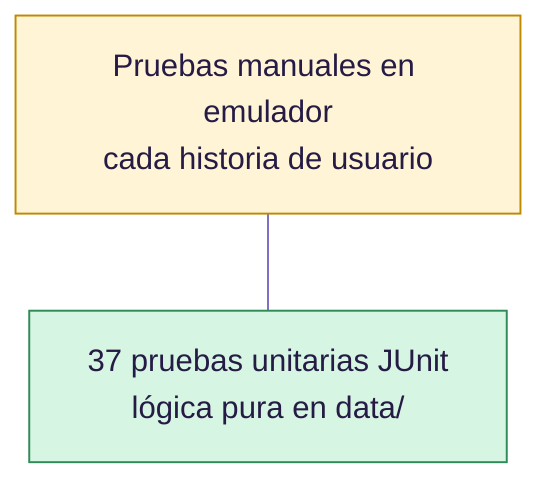

# 5. Buenas prácticas de desarrollo

Este documento muestra qué prácticas de ingeniería de software se aplicaron, dónde se ven en el código y qué quedó pendiente.

## 1. Principios SOLID

| Principio | Qué dice | Dónde se aplica |
|---|---|---|
| **S** · Responsabilidad única | Cada clase tiene un solo motivo para cambiar | `CalculadoraNotas` solo calcula; `NubeRepository` solo habla con Firestore; `Sincronizador` solo copia la nube a Room; `EnlaceCalendario` solo guarda el enlace |
| **O** · Abierto/cerrado | Extender sin modificar lo que ya funciona | Las reacciones de Lumi son datos (`Reaccion(cara, mensaje, confeti)`): una reacción nueva no cambia `ReaccionLumi` |
| **L** · Sustitución de Liskov | Una implementación puede reemplazar a otra | Los DAO son interfaces que Room implementa; App Check cambia de proveedor entre *debug* y *release* sin tocar el resto (`src/debug` y `src/release`) |
| **I** · Segregación de interfaces | Interfaces pequeñas y específicas | Un DAO por entidad (`MateriaDao`, `NotaDao`, `EntregaDao`) y uno aparte para la sincronización (`SincronizacionDao`) |
| **D** · Inversión de dependencias | Depender de abstracciones | Los repositorios reciben sus DAO y `NubeRepository` por constructor, con valores por defecto, lo que permite pasar dobles de prueba |

## 2. Separación en capas



- La interfaz **nunca** llama a Room ni a Firebase directamente.
- La **lógica de negocio** vive en funciones puras sin dependencias de Android, por eso se prueba con JUnit en milisegundos.
- Detalle en [ADR-0002](adr/0002-mvvm-con-repositorios.md).

## 3. Código limpio

- **Nombres que explican:** `notaNecesaria`, `materiasSinCrear`, `enlaceDeOtraCuenta`, `cambiosDeCalendario`. El código está en español, igual que el dominio y los usuarios.
- **Código autoexplicativo en vez de comentarios:** se eligieron nombres claros y funciones cortas para que el código se entienda sin comentarios.
- **Constantes con nombre** en lugar de números mágicos: `DIAS_A_IMPORTAR = 180L`, `TAMANO_MAXIMO = 5 * 1024 * 1024`, `HORA_DE_AVISO = 8`, `DIAS_DE_PRIORIDAD = 7L`.
- **Inmutabilidad:** los modelos son `data class` con `val`; para cambiar algo se usa `copy()` (`entrega.copy(entregada = true)`).
- **Seguridad de nulos:** una nota sin calificar es `valor: Double? = null`, y el compilador obliga a tratar ese caso.
- **Archivos con una sola responsabilidad:** la pantalla de Entregas llegó a 903 líneas y se dividió en `EntregasScreen` (estado y contenido), `EntregasTarjetas`, `FilaEntrega` y `EntregasDialogos`, sin cambiar su comportamiento: las 37 pruebas siguieron pasando.
- **Sin duplicación:** textos de fecha compartidos (`textoDias`, `textoFecha`) y componentes reutilizables (`Pildora`, `LumiAnimada`, `ReaccionLumi`).

## 4. Programación reactiva y concurrencia

- Room expone `Flow`; los ViewModel los convierten en `StateFlow` con `stateIn(WhileSubscribed(5000))`, que deja de escuchar 5 segundos después de salir de la pantalla y así no gasta recursos al rotar.
- Las operaciones lentas son `suspend` y se ejecutan en `viewModelScope`, que las cancela si la pantalla se cierra.
- La descarga del calendario corre en `Dispatchers.IO`; el `Sincronizador` usa un hilo propio con `limitedParallelism(1)` para que las escrituras a Room no se pisen.
- Un pedido viejo de la frase del día se **cancela** antes de lanzar uno nuevo, para que una respuesta tardía no reemplace a la correcta.

## 5. Pruebas

### Pirámide de pruebas



| Suite | Pruebas | Qué cubre |
|---|---|---|
| `CalendarioTest` | 14 | Lector iCal, zonas horarias, enlaces, importación, ediciones, ocultas, materias sugeridas, dueña del enlace |
| `PlanDelDiaTest` | 7 | Prioridad: vencidas, hoy, peso, cercanía, al día |
| `CalculadoraNotasTest` | 6 | Promedio, porcentaje evaluado, nota necesaria y redondeo |
| `ContextoLumiTest` | 4 | Datos que recibe Gemini |
| `SincronizacionTest` | 3 | Estado de la nube, iniciales y saludo |
| `ResumenSemestreTest` | 2 | Promedio ponderado por créditos |
| `ExampleUnitTest` | 1 | Plantilla del proyecto |

**Prácticas aplicadas**

- Nombres de prueba que describen el comportamiento: `respetaLasEdicionesDelUsuario`, `lasVencidasVanPrimero`.
- Estructura **Preparar → Actuar → Verificar** en cada prueba.
- La fecha de "hoy" se pasa como parámetro (`planDelDia(hoy, entregas)`), así las pruebas no dependen del día en que se ejecutan.
- Cada error encontrado en el emulador terminó en una prueba nueva (por ejemplo, el calendario que se desconectaba al cerrar sesión).

```bash
./gradlew :app:testDebugUnitTest
```

## 6. Seguridad

| Práctica | Implementación |
|---|---|
| Mínimo privilegio en la base | Reglas de Firestore: cada usuario solo lee y escribe `usuarios/{uid}` |
| Sin secretos en el código | Gemini se llama con Firebase AI Logic, sin clave de API; `local.properties` está en `.gitignore` |
| Protección de la API | App Check con Play Integrity en *release* |
| Minimizar datos enviados | Gemini recibe materias, notas y fechas; nunca correo ni enlaces |
| Datos sensibles en el dispositivo | El enlace del calendario queda en `SharedPreferences` privadas y se olvida si entra otra cuenta |
| Validación de entradas | `normalizarEnlace` solo acepta `https` y `webcal`; descargas limitadas a 5 MB y 15 s |
| Limpieza al salir | Cerrar sesión borra la base local |

`google-services.json` está en el repositorio a propósito: identifica el proyecto, no es una contraseña, y la protección real está en las reglas y en App Check.

## 7. Experiencia de usuario y accesibilidad

- **Estados vacíos** con instrucciones ("Aún no tienes notas. Toca + para agregar la primera").
- **Mensajes de error** que dicen qué pasó y qué hacer, sin términos técnicos.
- **Confirmación** antes de acciones destructivas (borrar materia, desconectar calendario, cerrar sesión).
- **Gestos** para lo frecuente y botones visibles para lo mismo, para quien no use gestos.
- **Lectores de pantalla:** los botones de solo ícono tienen `contentDescription` ("Marcar lista: …", "Borrar: …").
- **Español correcto:** singular y plural ("1 crédito", "1 entrega nueva").

## 8. Control de versiones

- Repositorio público en GitHub con historia lineal en `main`.
- Mensajes con el formato de **Conventional Commits** (`feat:`, `fix:`, `docs:`) desde la mitad del proyecto.
- Un commit por funcionalidad completa y probada (ver [historial](06-historial.md)).
- `.gitignore` excluye compilados, cachés de Gradle y `local.properties`.

## 9. Documentación

- README con instalación, arquitectura y evidencia.
- Decisiones registradas como [ADR](adr/README.md).
- [Historias de usuario](02-historias-de-usuario.md) con criterios de aceptación y [matriz de trazabilidad](03-requisitos.md#matriz-de-trazabilidad).
- Diagramas como código (Mermaid), versionados junto al código.

## 10. Deuda técnica conocida

Ser honesta sobre lo pendiente también es una buena práctica. Esto se haría antes de publicar en Google Play:

| Deuda | Riesgo | Cómo resolverla |
|---|---|---|
| Migración destructiva de Room | Perder cambios sin subir al actualizar la app | Escribir `Migration` y probar con `MigrationTestHelper` ([ADR-0009](adr/0009-migracion-destructiva-de-room.md)) |
| Sin inyección de dependencias | Los ViewModel son difíciles de probar | Agregar Hilt |
| Sin pruebas de interfaz | Un cambio visual puede romper un flujo | Pruebas con `compose-ui-test` en `androidTest` |
| Sin integración continua | Las pruebas dependen de ejecutarlas a mano | GitHub Actions que corra `testDebugUnitTest` en cada push |
| Sin ofuscación en *release* | APK más grande y fácil de inspeccionar | Activar `isMinifyEnabled` con R8 |
| Textos dentro del código | Difícil traducir la app | Mover a `strings.xml` |
| API deprecada al deslizar una entrega | Puede dejar de funcionar en una versión futura de Compose | Reemplazar `confirmValueChange` de `rememberSwipeToDismissBoxState` por anclas dinámicas |
