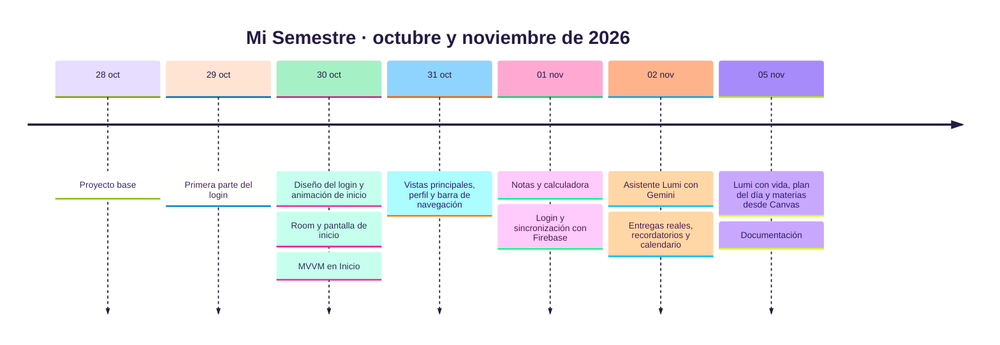

# 6. Historial del proyecto

El desarrollo se hizo en iteraciones cortas: cada una terminó con una funcionalidad probada en el emulador y subida a GitHub.

## Iteraciones

| # | Fecha | Commit | Qué se logró | Historias |
|---|---|---|---|---|
| 0 | 28/10 | `5e19609` | Proyecto base en Android Studio con Compose | — |
| 1 | 29–30/10 | `0955155`, `62b7eaf`, `e90a3e4` | Pantalla de login y su diseño | HU-01, HU-02 (interfaz) |
| 2 | 30/10 | `2106558` | Animación de bienvenida con Lumi | — |
| 3 | 30/10 | `bb39248`, `63d55f4` | Base local con Room y patrón MVVM en Inicio | HU-04 |
| 4 | 31/10 | `2858fa8` | Materias, perfil y barra de navegación | HU-04, HU-17 |
| 5 | 01/11 | `c01a2fd` | Notas, promedio y nota necesaria | HU-05, HU-06, HU-07 |
| 6 | 01/11 | `680fe3c` | Cuentas con Firebase y sincronización offline-first | HU-01, HU-02, HU-03 |
| 7 | 02/11 | `6585f35` | Asistente con Gemini y App Check | HU-14 |
| 8 | 02/11 | `824e4a0` | Entregas, importación iCal y recordatorios | HU-08, HU-10, HU-12 |
| 9 | 05/11 | `5556b1b` | Plan del día, reacciones, niveles, gestos, materias desde Canvas | HU-09, HU-11, HU-13, HU-15, HU-16, HU-18 |
| 10 | 05/11 | — | README, documentación, ADR y diagramas UML | — |

## Problemas encontrados y cómo se resolvieron

| Problema | Causa | Solución |
|---|---|---|
| Gemini respondía "free tier is not available" | El proyecto de Google AI Studio estaba restringido | Vincular facturación sin comprar créditos; el proyecto quedó en nivel gratuito |
| Los nombres de materia de Canvas eran muy largos | Canvas agrega el código del curso entre corchetes | `nombreDeMateria` los limpia; cubierto por `limpiaElNombreDelCursoDeCanvas` |
| La frase del plan saludaba y hablaba de otra entrega | Se le pasaba todo el contexto con las instrucciones del chat | Instrucciones propias para la frase, solo la entrega elegida y límite de largo |
| Una frase vieja reemplazaba a la nueva | Dos pedidos a Gemini al mismo tiempo | Cancelar el pedido anterior antes de lanzar otro |
| El calendario "se desconectaba solo" | El enlace se borraba al cerrar sesión | Guardar la dueña del enlace y olvidarlo solo si entra otra cuenta ([ADR-0008](adr/0008-enlace-del-calendario-solo-local.md)) |
| "Ahora no" escondía las materias para siempre | Se guardaban como ignoradas sin forma de recuperarlas | Al tocar Actualizar se vuelven a sugerir |
| Respuestas de Lumi cortadas en el emulador | El escaneo HTTPS del antivirus interrumpe la transmisión | Desactivar ese escaneo al desarrollar y grabar |
| La reacción de Lumi tapaba el texto | Fondo opaco | Fondo translúcido al 80% |
| "1 créditos" | Plural fijo | Singular y plural según la cantidad |
